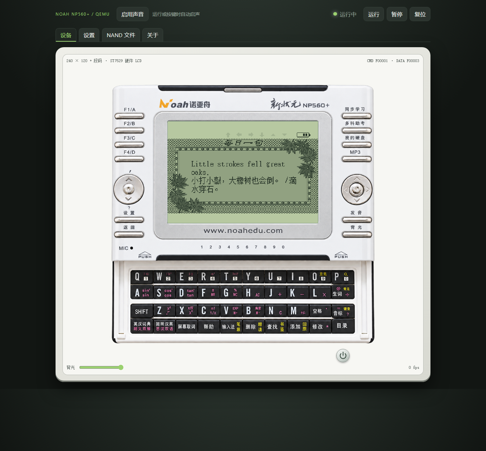
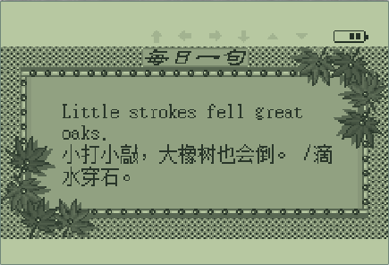

# NP560+ 模拟器

基于 QEMU 的诺亚舟 NP560+ 模拟器。Windows 版无需安装 WSL、MSYS2 或 Python；
浏览器显示真机 LCD 和可点击的键盘，支持 NPE 游戏、MP3 与 NAND 文件管理。

## 快速开始（Windows x64）

1. 从 [Releases 页面](https://github.com/HelloClyde/np560-qemu/releases) 的最新版本下载四个文件：
   `np560-windows-x64.zip`（模拟器）、`NP560.PRG`、`resident.bin`、`system.nand`。
2. 解压模拟器；把后三个文件放进解压后的 `np560-windows-x64/images/` 文件夹，
   文件名保持不变。它们是三个不同用途的镜像，只有 `system.nand` 是 NAND 镜像。
3. 双击 `Start-NP560.cmd`，保持命令窗口开启，再打开
   [http://127.0.0.1:8765/](http://127.0.0.1:8765/)。首次启动会自动创建设备。
   在网页中点击“启用声音”或任一设备键后，浏览器才允许播放声音。

进度保存在 `device/` 中的 NAND 增量日志；下次仍从同一文件夹启动。
不要同时开启两个使用同一设备的实例。进入“NAND 文件”页会先让模拟器关机，
确认后才能安全浏览、下载或导入文件。

`NP560.PRG` 是升级包中的 4 MiB 程序映像；`resident.bin` 是由源码重建的
resident ROM/HLE 包，并非完整原厂 mask-ROM 转储。部分原厂功能与游戏兼容性仍在完善。

开发构建、镜像来源与校验、已知限制和逆向记录见 [doc/](doc/)、
[发布说明](doc/release_process.md) 与 [项目计划](doc/plan.md)。
